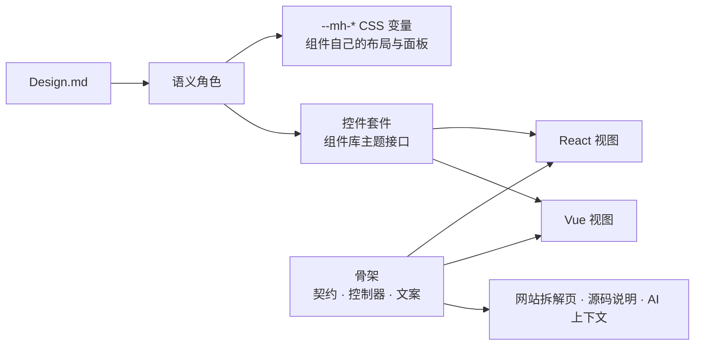

# 架构：骨架只写一次

Mihua Blocks 想回答一个设计工程化的问题：**同一个复合组件，怎样才能换框架、换组件库、换设计规范，而不用重写？**

答案是把组件拆成可以独立替换的层。骨架（结构、状态、交互、配置）只写一次；框架、组件库、规范都是贴在骨架外面的层。

## 五层

| 层       | 包                                         | 负责什么                                                          | 例子                                                    |
| -------- | ------------------------------------------ | ----------------------------------------------------------------- | ------------------------------------------------------- |
| 规范     | `Design.md`（`designs/mono`、`designs/blue`、`designs/stress`） | 品牌的决定：主色、圆角、字号、间距                                | 蓝色规范把主操作设为 `#3370FF`                          |
| 语义角色 | `@mihua/spec`                              | 把决定翻译成组件能懂的角色                                        | `action.primary`、`radius.control`、`size.controlLarge` |
| 骨架     | `@mihua/core`                              | 契约、配置、状态控制器、宿主接口、文案、布局样式                  | 登录控制器、五种布局的定义                              |
| 控件套件 | `react/src/kits/*`、`vue/src/kits/*` | 把「主按钮」翻译成某个组件库的真实组件，把 token 交给它的主题接口 | `antdKit`、`arcoKit`、`shadcnKit`、`elementKit`、`tdesignKit` |
| 框架视图 | `@mihua/react`、`@mihua/vue`               | 用 React 或 Vue 把部件摆成布局                                    | `<Login>`、`Login.vue`                                  |

### 四层在仓库里的位置

讲这套方法时常用另一种分法：**视觉、控件、结构、逻辑**四层（从「设计稿上看得见的」往「页面背后的」数）。它和上面的五层是同一套东西换个角度切：五层按「包」分，四层按「谁负责什么决定」分。对照：

| 四层 | 负责什么决定 | 在仓库里 | 对应上面的五层 |
|---|---|---|---|
| 视觉 | 颜色、字号、圆角、尺寸、图标这些取值 | `designs/<规范>/Design.md`（规范文件，取值的源头），`spec/src/roles.ts`（语义角色）、`spec/src/builtin.ts`（把 Design.md 读成内置规范）、`spec/src/icons.ts`（图标集） | 规范 + 语义角色 |
| 控件 | 每种控件统一成什么样，以及在每个组件库里怎么做到 | `spec/src/controls.ts`（控件规格），`react/src/kits/*`、`vue/src/kits/*`（套件） | 控件套件（加上规格） |
| 结构 | 页面上有什么、怎么排 | `core/src/admin/frame.ts`、`core/src/customers/list.ts`（结构定义），`core/styles/`（布局），`react/src/blocks/*`、`vue/src/blocks/*`（视图） | 骨架里的结构、布局 + 框架视图 |
| 逻辑 | 状态和交互：选了什么、筛了什么、提交以后怎样 | `core/src/**/controller.ts`（状态控制器），React、Vue 共用一份 | 骨架里的控制器 |

换组件库只动「控件」那一层的套件；换规范只动「视觉」那一层的取值；换框架只换「结构」里的视图；「逻辑」哪种都不动。



使用时只需要一行：

```tsx
<MihuaProvider kit={antdKit} spec={blueSpec}>
  <Login config={{ variant: 'split' }} />
</MihuaProvider>
```

换 `kit` 就是换组件库，换 `spec` 就是换规范，把 `@mihua/react` 换成 `@mihua/vue` 就是换框架。

## 七条原则

1. **组件只认角色，不认取值。** 视图和布局样式里没有一个写死的颜色或尺寸，全部读 `--mh-*` 变量。规范只写与默认值（Mihua 黑白）不同的角色。
2. **骨架与框架无关。** 控制器是纯 TypeScript：React 用 `useSyncExternalStore` 订阅，Vue 用 `shallowRef` 订阅。控制器只返回错误码（例如 `error.identity.phone.cn`），由视图按当前语言取字。没有界面订阅时它会自动暂停，放弃进行中的请求、停掉计时器，所以两种框架都不需要手动销毁。
3. **组件库之间的差异只存在于套件里，接上规范后各组件库长得一样。** 一份 Design.md 只给出取值；同一个 40px，在每个组件库里由不同的规则决定（antd 是上下内边距加一行文字，Element 是 CSS 变量，Arco 是固定档位，shadcn 是类名）。套件先用组件库自己的接口：antd 的主题 token 和组件 token，Arco 输入框的 `height` 属性，Element 和 shadcn 的 CSS 变量；接口够不着的（Arco 的灰底输入框和固定档位、Element 的复选框和标签栏、shadcn 的胶囊标签栏），在套件样式表里逐项改，只在接上规范时生效，不用 `!important`。「原生外观」就是不做这一步。
4. **布局属于骨架。** 卡片、间距、扫码区这些「组件库没有的东西」，写在 `@mihua/core/styles` 里，React 和 Vue 共用同一份。
5. **契约是唯一来源。** 每个组件的任务、结构分区、不变量、状态、宿主接口、消费的 token、无障碍要求都写在契约里。网站的拆解页、源码包说明、给 AI 的上下文都从契约生成，不另写一份。
6. **图标也属于规范。** 设计通常用一套自己的图标或一套开源图标，而不是每个组件库各带的那套。视图和套件只说「这里要一个下拉箭头」「这里要一个隐藏密码」（语义图标 `IconName`），规范的 `icon.set` 决定画成哪一套（`ICON_SETS`：Lucide、Mihua 自绘……）。React 和 Vue 的 `Icon` 用同一份图形数据画 SVG；接上规范时，套件把它塞进组件库留的图标位（antd 的 `suffixIcon`、Element 的 `loading-icon`、Arco 的 `arrowIcon` 和复选框的 `icon`）；组件库没留位置、只用 CSS 画的（antd、Element 复选框里的对勾），用同一份图形生成的 CSS 遮罩 `--mh-icon-*`；连图标也换不掉的（Arco 的密码显隐和加载图标），由套件自己画。
7. **如实记录对齐的做法。** 每个套件都有 `adaptations`（适配记录），逐条写明这个组件库默认和统一设计不一样的地方、套件是怎么对齐的、用的什么手段，比如 Arco 只有 28 / 32 / 36px 三档控件高度，套件用 `height` 属性和行内高度改成规范值。

## 目录

```text
spec/       规范层：语义角色、规范校验、Design.md 读写、内置规范（黑白、蓝色）、颜色换算、
            控件规格（controls.ts，含尺寸两档）、适配记录和组件库档案（adaptation.ts）、
            部件地图的部件名（parts.ts）、图标集（icons.ts）
core/       组件骨架：login/（类型、布局定义、配置、控制器、契约、文案、演示适配器）
            admin/（后台页面框架的结构和状态控制器）
            customers/（客户列表：演示数据、结构、筛选 / 排序 / 分页 / 勾选 / 对话框表单的状态控制器）
            styles/（React 与 Vue 共用的布局样式：登录框、后台页面框架、客户列表）
react/      MihuaProvider、套件接口、kits/（antd、arco、shadcn）、blocks/（login、admin）
vue/        MihuaProvider、套件接口、kits/（element、tdesign）、blocks/（login、admin）
audit/      自动检查：通用的量取、对比和浏览器驱动；不认识任何组件库、任何组件
examples/   演示页（所有登记的组件库并排、三档外观切换）和检查页；
            组件库登记表 src/kits.ts、检查场景 src/scenes/（登录框、控件样张、后台页面框架、客户列表）
docs/       架构、三份做法说明、取舍记录
designs/    设计规范 Design.md（黑白、蓝色、压力测试），规范的源头
skills/     Claude Code 的 Skill（内容都指向 docs/）
```

## 新增一个组件

1. 在 `core/src/<组件>` 写：类型、配置 schema（zod，同时承担校验、默认值、配置面板字段）、控制器（纯 TypeScript，只返回错误码）、契约、中英文案、演示适配器。
2. 为控制器写行为测试：校验、异步请求的取消与过期、计时器、暂停与恢复。
3. 在 `core/styles` 写布局样式，只使用 `--mh-*` 变量。
4. 在 `@mihua/react` 与 `@mihua/vue` 各写一份视图：由部件组合，控件只通过 `useKit()` 获取。
5. 为两份视图写同一条用户流程测试，保证行为一致。
6. 如果需要新的基础控件，按「给套件加一个新控件」先加控件。
7. 在 `examples/src/scenes/` 加一个场景（React、Vue 两份视图 + 要核对的状态和交互），在 `scenes/index.ts` 登记。

## 新增一个组件库（套件）

见 [接入一个新组件库](接入一个新组件库.md)。要点：实现套件接口（`Provider`、每种控件、`parts`、`profile`、`adaptations`），在 `examples/src/kits.ts` 登记一行，跑 `npm run check` 修到全过。检查工具不用为它改；发现量法或环境的问题，改成通用规则。

## 新增一个控件

见 [给套件加一个新控件](给套件加一个新控件.md)。要点：控件规格 → 接口 → 部件名 → 每个套件各实现一遍 → 放进控件样张 → 检查全过。

## 新增一套图标

在 `spec/src/icons.ts` 的 `ICON_SETS` 里加一项：名称、出处与许可、线宽，以及每个 `IconName` 的图形（24×24 画板上的 path、circle、rect、line）。规范里写 `icon.set: <名字>` 就会用上它，所有组件库一起换。自动检查会检查每个图标是不是规范图标集里的、位置、大小和颜色是否一致。

## 新增一份规范

照 `designs/mono/Design.md` 写一个 Design.md：开头是 `id`、`name`、`revision` 元信息，正文随意，机器只读 ` ```mihua-tokens ` 代码块。未知角色和非法取值会直接报错，不会被悄悄忽略。放进 `designs/<id>/Design.md`，在 `examples/src/specs.ts` 里登记一行（`?raw` 引入、`parseDesignMarkdown` 读出来），演示页和自动检查就多一套规范。

`designs/` 里的三份（黑白、蓝色、压力测试）就是规范的源头：内置的 `monoSpec`、`blueSpec`（`spec/src/builtin.ts`）和演示页、检查都从它们读。改里面一个数（比如 `size.control: 32px` 改成 `36px`），`npm run dev` 的演示页里五个组件库的控件一起变；`npm run check` 照样能证明五个组件库还是一样。

## 测试与检查

`npm run check` 依次运行 TypeScript 与 Vue 类型检查、全部测试、范例构建、自动检查（`npm run audit:kits`）。

自动检查打开 `examples/audit.html`，把所有登记的组件库并排渲染同一个场景、同一个状态，用真实浏览器量取用户看得见的东西（文字、框、图标的位置、大小、颜色、边线、圆角），再用真实的鼠标和键盘核对交互，所有组件库逐项对比，数字允许 0.6px 误差。**按区域量**：场景里标了 `data-region` 的元素各是一个区域，区域里的东西按区域自己的左上角量，报告直接指到「哪个区域、哪个部件、哪一项」。需要本机有 Chrome（或设置 `CHROME_PATH`）。

## 当前状态

- 已完成：登录（五种布局）× React（shadcn、antd、arco）× Vue（Element Plus、TDesign）× 规范（黑白、蓝色、压力测试）；控件样张（默认和大号两档的按钮、输入框、选择框、复选框、开关）；后台页面框架（顶栏、可收起的侧栏导航、面包屑、页头，新控件：导航菜单、面包屑、下拉菜单、头像、徽标）。
- 已完成：客户列表（筛选栏、数据表格、编辑对话框；新控件：表格、分页、标签、日期范围、对话框、单选、多行输入）。各组件库做法不一样的取舍见 `docs/取舍记录.md`。
- 已知问题：Arco Design（到 2.66.17 都是）在 React 19 的开发模式下会在控制台输出 `Accessing element.ref was removed in React 19`：它的选择框、标签栏、日期范围、对话框内部读了子元素的 `element.ref`（`_util/react-dom.js` 里的 `callbackOriginRef`），套件改不到，等 Arco 修（arco-design#2891）；构建出来的页面没有。套件自己的写法已经避开（下拉菜单不给 Arco 的 Menu 挂 ref、菜单项不用 Fragment 包）。范例一次性加载所有组件库，体积较大。
